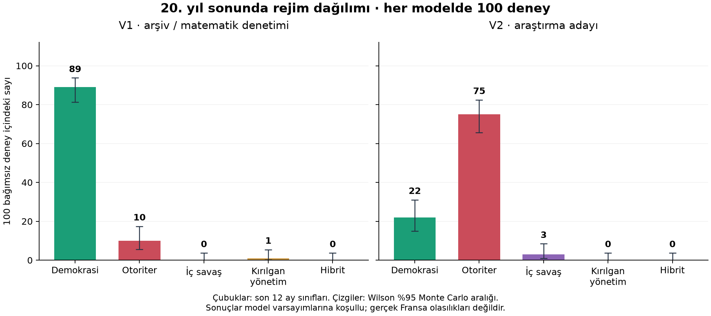

# V2 deneyleri ve yapı belirsizliği

**V2 bir araştırma adayıdır. Tam 0/1 kırpılmasını kaldırmış, fakat siyasi endekslerde sınıra yakın yığılmayı ve güçlü çekicileri ortadan kaldırmamıştır. Nihai bilimsel olarak doğrulanmış model veya Fransa tahmini olarak sunulmamalıdır.**

## Deney öncesi taahhüt ve kapsam

MODEL_V2.md deneyden önce SHA256 4759fb9daeedabaa218579c661b69b4a7c91ac2d1ead58a967f1d5342c13fe6b ile kaydedildi. Deney öncesi ve sonrası model kodu SHA256 aynı: ee2376ef3f623ddc42370de98485eb5dc7f780ceca31234ee11653efeeec3ed2. Hiçbir rejim payı hedeflenmedi; sonuç görüldükten sonra katsayı seçilmedi.

15 yapılandırma × 100 bağımsız tohum × 240 ay = 1500 V2 yörüngesi. Ana dört başlangıç ve duyarlılık varyantlarında 2026–2125 tohumları kullanıldı. Aynı yapılandırma içinde tohumlar bağımsızdır; farklı yapılandırmalar arasında eşleştirilmiştir. V1 ve V2 farklı rastgele çekiliş düzenleri kullanır; sürümler arasında aynı tohumun aynı tarihsel şok yolu olduğu iddia edilmez.

## Asıl grafik: 100 deneyin son rejim dağılımı

Tekil yol grafiği bir deneye aittir. Aşağıdaki tablo bütün 100 sonucun sınıflarını sayar; ortalama yörüngeyi sınıflandırmaz. Sınıflama her yolun son 12 ay ortalamalarıyla yapılır.

| Rejim | V1 (100) | V2 adayı (100) | V2 Wilson %95 MC aralığı |
|---|---:|---:|---:|
| Demokrasi | 89 | 22 | %15.0–%31.1 |
| Otoriter | 10 | 75 | %65.7–%82.5 |
| İç savaş | 0 | 3 | %1.0–%8.5 |
| Kırılgan yönetim | 1 | 0 | %0.0–%3.7 |
| Hibrit | 0 | 0 | %0.0–%3.7 |

V1’in %89 demokrasi, V2’nin %75 otoriter sonuç üretmesi, birinin doğru hipotezi kanıtladığını göstermez. Değişiklik paketi birden çok mekanizma ve öncül içerir; fark tek bir düzeltmeye nedensel olarak atfedilemez. Yapı belirsizliği, 100 tohumdan hesaplanan örnekleme aralığından çok daha büyük olabilir.

## Başlangıç koşulları

| Başlangıç (her biri 100) | Demokrasi | Otoriter | İç savaş | Kırılgan | Hibrit |
|---|---:|---:|---:|---:|---:|
| Devrim | 22 | 75 | 3 | 0 | 0 |
| Uzlaşma | 99 | 1 | 0 | 0 | 0 |
| Parçalanma | 0 | 97 | 3 | 0 | 0 |
| Kurumların devamı | 100 | 0 | 0 | 0 | 0 |
| Parçalanma · yüksek şok/düşük çözüm stres deneyi | 0 | 68 | 32 | 0 | 0 |

Kurumların devamı ve uzlaşma, varsayılan mekanizmalar altında demokrasi çekim havzasında kalıyor. Parçalanma ve devrim başlangıçları büyük ölçüde otoriter havzaya gidiyor. Stres deneyinde 32 iç savaş sonucu görülüyor; yüksek çatışma varsayımıyla çatışma üretmek ampirik destek değildir. Bu örneklemlerde hibrit ve kırılgan sınıflar görülmedi. Çeşitlilik veya bütün sınıfların eşit erişilebilirliği kanıtlanmış değildir.

## Sınır sorunu gerçekten giderildi mi?

| Endeks | V1 tam 0/1 (%) | V2 tam 0/1 (%) | V2 ≤.01 / ≥.99 (%) |
|---|---:|---:|---:|
| İktidar yoğunlaşması | 69.22 | 0.00 | 45.01 |
| Özgürlükler | 67.71 | 0.00 | 63.21 |
| Siyasal şiddet | 67.04 | 0.00 | 6.58 |
| Ekonomik refah | 54.41 | 0.00 | 0.00 |
| Toplumsal güven | 63.61 | 0.00 | 0.00 |
| Kurumların bağımsızlığı | 68.37 | 0.00 | 37.10 |

Bütün aylar ve bütün ana deneyler dahil. V2 özgürlük kayıtlarının **%63,21’i hâlâ .01/.99 dış bandında**. Bu nedenle yalnızca clip yerine sigmoid koyarak modelin yapay dengesi tamamen çözülmüş sayılamaz. Refah ve güvenin bu dış bandında gözlem yoktur; bu iki değişken artık siyasi endekslerle birlikte 1’e gitmez. Son 60 ayın altı endeks üzerindeki ortalama standart sapması V2’de 0.02398. Bu ortalama siyaset boyutlarındaki düşük oynaklığı örtebilir.

## Matematiksel garanti ve kalan kararsızlık

Her endeks için a=kσ(u), b=k(1−σ(u)), x′=(1−a−b)x+a. 0<k<1, sonlu u için 0<a,b<k ve a+b=k. [0,1] ileriye değişmez; x=0 iken x′=a>0, x=1 iken x′=1−b<1. Tam sınırdan içeri hareket ve sınıra yakın güçlü çekici bulunması farklı konulardır.

İtki donmuşsa x*=σ(u), türev 1−k. Fakat u=u(x) olduğunda Jacobian:

`J = I − diag(k) + diag(k · σ(u) · (1−σ(u))) · Du(x)`

Orta bölgede σ′≈.25. Diğer bağlar yok sayıldığında varsayılan C öz geri beslemesi diagonal katkıyı .945+.055*.25*6 = **1.0275** yapabilir; L için **1.015**, I için **1.009**. Tam özdeğerler bağlı sistemden hesaplanır; bu basit hesap merkezi bölgenin kendiliğinden kararlı olmadığını gösterir. Sigmoid sınır garantisi, kararlılık garantisi değildir.

Donmuş A=.5,D=.5,F=.4,B=.55,J=.5,Q=.5,S=.6, etmen güveni=.5; ortalama baskılar (.28,.09,.106667), çevrim 0, yenilik 0 ve self_feedback=1 için bulunan kapanış kökleri:

| C | L | V | W | T | I | Spektral yarıçap | Yerel durum |
|---:|---:|---:|---:|---:|---:|---:|---|
| 0.99447 | 0.00189 | 0.33874 | 0.44466 | 0.13287 | 0.00825 | 0.96711 | çekici |
| 0.00314 | 0.99694 | 0.01389 | 0.64522 | 0.78932 | 0.99253 | 0.95694 | çekici |
| 0.45011 | 0.15112 | 0.08768 | 0.55925 | 0.31107 | 0.51045 | 1.07231 | kararsız |

A=.25,.5,.75 ve self_feedback=.5,1,1.5 taramasında çoklu iç sabit noktalar bulundu. Çekiciler hâlâ siyasi uçlara yakındır; merkezde/sınır havzalarında kararsız kökler vardır. Bu, V2’de kalan iki kutupluluğun yapısal açıklamasıdır. Arama tüm kökleri garanti etmez. Beklenen baskı ve sıfır yenilik kapanışı kullanılmıştır; E[σ(u+ε)] genel olarak σ(E[u]) değildir. Tam stokastik ABM için bu tablo bir kararlılık ispatı değildir.

## Parametre duyarlılığı (her varyant 100 tohum)

| Parametre | Değer | Otoriter (%) | Temele göre fark (yüzde puan) | Eşleştirilmiş MC standart hatası | 12 aylık yüksek şiddet görülme payı (%) |
|---|---:|---:|---:|---:|---:|
| resilience | 0.5 | 66 | -9 | 0.0288 | 38 |
| resilience | 1.5 | 80 | +5 | 0.0261 | 46 |
| shock_scale | 0.0 | 76 | +1 | 0.0225 | 0 |
| shock_scale | 1.5 | 70 | -5 | 0.0219 | 59 |
| leader_bias | -0.25 | 24 | -51 | 0.0522 | 14 |
| leader_bias | 0.25 | 91 | +16 | 0.0395 | 60 |
| self_feedback | 0.5 | 67 | -8 | 0.0273 | 37 |
| self_feedback | 1.5 | 81 | +6 | 0.0239 | 49 |
| conflict_resolution | 0.5 | 76 | +1 | 0.0100 | 47 |
| conflict_resolution | 1.5 | 75 | +0 | 0.0000 | 41 |

resilience artışı bu varsayımlarda otoriterliği monoton azaltmadı (%66 → %75 → %80). Çünkü −1.8*r*(2I−1) terimi I<.5 iken merkezileşmeyi artırıyor, I>.5 iken azaltıyor. Bu parametrenin etiketi gerçek bir siyasi müdahaleyi temsil etmez; kurumsal geri besleme kuvvetidir. Bu bulgu saklanmamalıdır. Lider_bias −.25 ile %24, +.25 ile %91 otoriter çıktı; lider öncülü hâlâ çok etkili. Şokları kapatmak iç savaş sayısını 3’ten 0’a indirdi; otoriter sayı 75’ten 76’ya çıktı. Son sınıfın değişmemesi bütün yolun değişmediği anlamına gelmez.

Tek etkenli tarama parametre etkileşimlerini ve tüm yapısal belirsizliği tüketmez. ±.05 daha gevşek/katı otoriter eşikleri bu örneklemde 75/100 sayısını değiştirmedi; bu, sınıfa ayrılan yolların eşiklerden uzak olduğunu gösterir, modelin doğru olduğunu değil.

## Güvenilirlik sınırları ve sonraki model önerisi

- V1 kod doğrulaması toplumsal geçerlilik değildi; V2 için de aynı ayrım korunur. Tahmin başarısı, ampirik kalibrasyon veya politika değerlendirmesi iddia edilmez.
- Yüksek öz pekiştirme ve C↔I/L karşılıklı etkileri hâlâ iki güçlü çekim havzası üretiyor. Bunlar gerçek veriyle desteklenmeden varsayılan araştırma gerçeği sayılmamalı.
- Daha savunulabilir sonraki modelde kurumların oluşma/aşınma hızları, bütçeler, seçimde koalisyon değişimi, bireylerin protesto maliyetleri ve şiddetin örgütsel kapasitesi ayrı gözlenebilir mekanizmalarla tanımlanmalı. Toplam siyasi endeksler bu mekanizmaların ölçümü olarak türetilmeli; birbirlerini yükselten keyfî endeks denklemleri azaltılmalı.
- Öz pekiştirme bulunan/bulunmayan alternatif yapı aileleri veri görmeden karşılaştırma planına alınmalı; tek bir model ailesinin katsayılarıyla istenen histogram üretilmemeli. Parametre öncülleri kaynaklandırılıp tarihsel çoklu vakalara kalibre edilmeli; ayrı vakalarda doğrulama ve örneklem dışı kontrol yapılmalı.
- Küresel duyarlılık, etkileşimler, nüfus ve zaman-adımı yakınsaması, alternatif rejim eşikleri, rejim geçiş süreleri ve nadir çatışma olayları için daha fazla tohum gerekir. 100 koşu nadir sınıfları kesin ölçmez.
- Başlangıç koşullarının gerçek Fransa’ya ait olduğu veya senaryoların gerçek sıklıklarda gerçekleşeceği iddia edilmez.

## Tekrar üretim

`python audit_v1.py` eski modeli değiştirmeden yeniden denetler. `python run_v2_study.py` 1500 önceden belirtilmiş V2 yörüngesini üretir. `python build_research_report.py` raporu ve sabit nokta ayrıntılarını yeniler. Model kaynak/hash ve deney planı research/v2 altındadır.

Yöntem kaynakları: [ODD, Grimm ve ark. 2020](https://www.jasss.org/23/2/7.html), [Windrum ve ark. 2007](https://www.jasss.org/10/2/8.html), [ten Broeke ve ark. 2016](https://www.jasss.org/19/1/5.html). Bu kaynaklar kullanılan siyasi katsayıları doğrulamaz.
